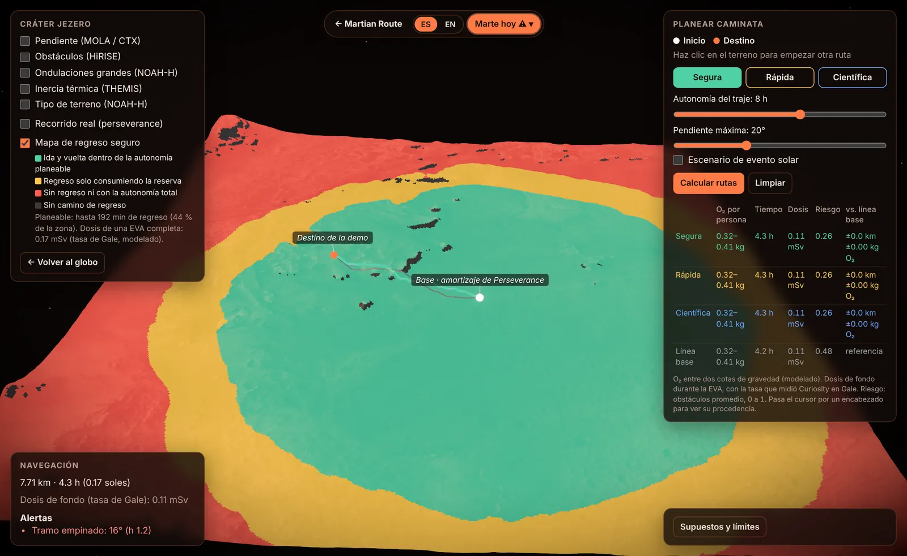

# Martian Route

Mapa 3D multicapa del cráter Jezero que planifica caminatas humanas en Marte por oxígeno, riesgo y regreso
seguro a la base, y no solo por distancia.

Proyecto para el NASA Space Apps Challenge 2026, reto *Interplanetary Survival Guide: Martian Map*. El explorador
elige un inicio y un destino y recibe tres rutas, Segura, Rápida y Científica, comparadas con la ruta más corta.
Cada una trae su consumo de oxígeno, su riesgo, su tiempo, su dosis de radiación y su punto de no retorno.



## El problema

En una caminata en Marte, el límite no es la distancia sino el oxígeno que el explorador lleva en el traje.
Entre la base y el destino hay escarpes, campos de bloques y arena suelta. Los rovers lo han vivido: Curiosity
ha tenido que adaptar sus rutas durante años por rocas y arena (Rankin et al., 2021), y Perseverance depende de
su navegación autónoma para cruzar Jezero (Verma et al., 2023).

Para una persona, una ruta corta que sube una pendiente fuerte o cruza terreno irregular puede gastar más oxígeno
que un rodeo y dejarla sin margen para volver. Planear una caminata exige saber, antes de salir, cuánto oxígeno
cuesta cada tramo, qué zonas no se pueden cruzar y desde dónde ya no alcanza para regresar.

## Qué existe y qué falta

Hicimos una revisión sistemática con la guía PRISMA 2020 (Page et al., 2021): de 2,448 registros incluimos 97
estudios.

| Antecedente | Qué hace | Qué no cubre |
| --- | --- | --- |
| Travesías de mínima carga metabólica (Peña-Asensio et al., 2024) | Calcula rutas de astronautas que minimizan el esfuerzo hacia zonas en sombra del polo sur lunar | Es para la Luna; no usa capas de Marte ni punto de no retorno |
| NaviGATOR (Richardson et al., 2024) | Asigna costo metabólico por celda y visualiza rutas de EVA lunar | Es para la Luna; sin datos marcianos |
| Métricas de rutas de rovers (Muñoz et al., 2023) y AutoNav (Verma et al., 2023) | Planifican y evalúan rutas de rovers en Marte | Optimizan la movilidad de un rover, no el oxígeno de una persona |
| Visores de datos, como NASA Mars Trek | Publican capas orbitales y miden distancias y perfiles de elevación | No proponen rutas ni calculan su costo para una persona |

**El vacío:** no encontramos una herramienta que planifique caminatas de una persona en Marte con datos reales y
que se valide contra el recorrido de un rover. Nuestro aporte no es la idea de optimizar por energía, sino la
integración de esas piezas para Marte y su validación.

## Datos y para qué se usa cada uno

Los datos son públicos y vienen de varias misiones de NASA. En la región de Jezero, todas las capas se llevan a
una grilla común de 600 × 600 celdas de unos 25 m. Cada capa y cada cifra de la app indica su procedencia:
observada, derivada o modelada. Fuentes y citas completas: [docs/creditos.md](docs/creditos.md).

| Capa | Misión o producto | Uso en el motor |
| --- | --- | --- |
| Relieve y pendiente | Modelo de terreno de CTX para Mars 2020 (MRO, USGS), 20 m | Pendiente, ascenso y celdas intransitables |
| Imagen del terreno | Ortomosaico de CTX para Mars 2020, 6 m | Textura del mapa 3D |
| Peligro del terreno | Clases NOAH-H sobre HiRISE (Barrett et al., 2022; Wright et al., 2022) | Peligro de 0 a 1 y zonas intransitables; clasifica el 95.4 % de las celdas |
| Firmeza del suelo | Inercia térmica de THEMIS (Mars Odyssey), 100 m | Inestabilidad del suelo |
| Minerales | Mineralogía de CRISM (MRO) | Valor científico del modo Científica; en integración (hoy solo en la región de prueba) |
| Recorrido real | Trayecto de Perseverance (Mars 2020, MMGIS de JPL) | Validación de las rutas |
| Radiación | RAD de Curiosity en Gale (Hassler et al., 2014; Guo et al., 2021) | Dosis por caminata, con el valor medido en Gale |
| Clima espacial | DONKI de NASA (CCMC, WSA-ENLIL) | Eyecciones solares previstas para Marte, en el panel "Marte hoy" |
| Rover en vivo | Posición e imágenes crudas de Perseverance | Ubicación del rover y sus imágenes recientes, en el panel "Marte hoy" |

Además de `jezero`, el repositorio trae dos regiones más con la misma arquitectura:

- `jezero_walk`: la zona de una caminata con el modelo de terreno y el ortomosaico de HiRISE, a unos 3 m por celda.
- `gale`: alrededor de Curiosity, con el DEM y el ortomosaico de HiRISE de la misión MSL. Gale no tiene NOAH-H, así
  que su peligro se deriva de la rugosidad del relieve.

## Cómo funciona

- **Modos de caminata.** Segura da más peso a la pendiente, el peligro y la inestabilidad del suelo. Rápida
  prioriza el tiempo. Científica suma el valor de los minerales del camino. La línea base, la ruta de distancia
  mínima que respeta la pendiente, sirve de referencia.
- **Oxígeno.** El motor parte de 0.07 kg de O₂ por hora y por persona en terreno plano a 2 km/h (unos
  3.5 × 10⁻⁵ kg por metro) y lo ajusta según la pendiente (Minetti et al., 2002) y el terreno. Como no hay
  mediciones con traje a la gravedad de Marte, el oxígeno se reporta como intervalo.
- **Límites del traje, editables.** Pendiente máxima de 20°, 2 km/h en plano, 8 h de autonomía con 20 % de reserva
  y 10 km desde la base.
- **Punto de no retorno.** Cada ruta marca el punto desde el que el regreso ya no cabe en la autonomía planeable.
- **Mapa de regreso seguro.** Colorea en verde las zonas desde las que se vuelve dentro de la autonomía, en
  amarillo las que exigen usar la reserva y en rojo las que no permiten volver.
- **Arquitectura.** El trabajo pesado (recortes, reproyección y grillas) se hace fuera de línea en el pipeline. La
  API combina las grillas según el modo y calcula la ruta en segundos, y la web la dibuja en 3D.

Todos los parámetros del modelo, con su fuente y sus límites, están en [docs/supuestos.md](docs/supuestos.md).

## Impacto

- **Exploración:** apoya la planificación de caminatas y el entrenamiento en análogos terrestres.
- **Educación:** convierte datos públicos de NASA en una experiencia que estudiantes y público pueden usar.
- **Ciencia abierta:** el código, los datos crudos de las regiones y los supuestos son abiertos, y el método se
  puede repetir en otros sitios, como ya se hizo con Gale.

## Estado y límites

**Logrado:** región real de Jezero en una grilla común, motor con tres modos, línea base, punto de no retorno, mapa
de regreso seguro y dosis, y visor 3D con tabla comparativa y panel de supuestos.

**Falta medir:** la comparación con el recorrido de Perseverance y las pruebas con usuarios se harán con rutas
congeladas después del evento. Todavía no reportamos cifras de ahorro de oxígeno, para no presentar como hallazgo
lo que aún es hipótesis.

**Límites conocidos:** el costo de oxígeno se calibra con datos lunares y terrestres, y la tasa de radiación se
midió en Gale, no en Jezero.

**Trabajo futuro:**

- Validar las rutas contra al menos 20 tramos del recorrido de Perseverance.
- Probar el visor con cinco evaluadores ajenos al equipo.
- Usar los avisos de eventos solares para suspender caminatas cuando suba la radiación.
- Actualizar el costo de oxígeno cuando existan mediciones con traje a la gravedad de Marte.

## Equipo

Maestría en Ingeniería para la Innovación y Desarrollo Tecnológico (MIIDT), Universidad Autónoma de Guerrero,
Chilpancingo, Guerrero.

| Integrante | Rol |
| --- | --- |
| Marco Tulio Ramirez Reyes | Líder del equipo; pipeline de capas, infraestructura y despliegue |
| Edgar David Mariano Ruiz | Ciencia y validación |
| Miguel Ángel Florencio Flores | Backend y dirección del frontend |
| Milton [__] | Componentes de interfaz |
| Williams Reyna Pérez | Pruebas de uso, demo y video |
| Jairo [__] | Idea inicial del proyecto |

El reparto de trabajo por integrante está en [docs/equipo/](docs/equipo/README.md).

---

## Estructura del repositorio

```
apps/web       Next.js + React Three Fiber  → Vercel
apps/api       FastAPI + motor de rutas A*  → Render / Railway
pipeline       GDAL/Rasterio, offline       → Cloudflare R2
packages/contracts  tipos TS generados del OpenAPI
data/raw       crudos de cada región (sí se versionan)
data/regions   salida del pipeline (no se versiona)
```

Arquitectura, contrato de la API y formato de datos: [docs/arquitectura.md](docs/arquitectura.md).

## Arranque local

Requisitos: Node 22+, Python 3.11+.

**1. Datos de prueba** (región sintética de Jezero en `data/regions/`; vuelve a generarla cuando un pull cambie
`pipeline/`):

```bash
cd pipeline
python -m venv .venv && .venv/Scripts/pip install -e ".[dev]"   # macOS/Linux: .venv/bin/pip
.venv/Scripts/marsdata synthetic
```

**2. API** en http://localhost:8000 (docs en `/docs`):

```bash
cd apps/api
python -m venv .venv && .venv/Scripts/pip install -e ".[dev]"
cp .env.example .env
.venv/Scripts/uvicorn app.main:app --reload
```

El panel "Marte hoy" consulta a NASA en vivo (`GET /live`). Saca una llave gratuita en https://api.nasa.gov y
ponla en `apps/api/.env` como `NASA_API_KEY`; sin internet, la API usa la copia de `app/live/snapshot.json`.
Para actualizar esa copia antes de una demo: `.venv/Scripts/python -m app.live` desde `apps/api`.

**3. Web** en http://localhost:3000 (repite `npm install` cuando un pull cambie `package-lock.json`):

```bash
npm install
cp apps/web/.env.example apps/web/.env.local
npm run dev:web
```

La portada está en `/` y el planificador de rutas en `/planner`; el botón fijo de la portada lleva ahí.

## Jezero y Gale con datos reales

`marsdata synthetic` genera una región inventada para las pruebas. Las regiones reales, `jezero` (CTX, ~25 m por
celda), `jezero_walk` (HiRISE, ~3 m por celda) y `gale` (HiRISE leído a 5 m, alrededor de Curiosity), se construyen
en `data/regions-real/`, que no se versiona. Fuentes y citas: [docs/creditos.md](docs/creditos.md).

**1. Datos.** Los archivos crudos de cada región ya vienen en el repo, en `data/raw/<región>/`, así que no hay que
descargar nada: basta con construir.

```bash
cd pipeline
.venv/Scripts/marsdata build --region jezero --out ../data/regions-real
.venv/Scripts/marsdata build --region jezero_walk --out ../data/regions-real
.venv/Scripts/marsdata build --region gale --out ../data/regions-real
```

Sin `--out`, `build` reemplaza la región sintética de `data/regions/`, que es la que esperan las pruebas de la API.
Gale no tiene NOAH-H: su capa de riesgo sale de la rugosidad del DEM (ver `docs/supuestos.md`). Minerales e hielo
todavía no tienen producto: `build` los omite.

`marsdata fetch --region <región>` solo hace falta para regenerar los crudos o agregar una región: baja completos el
DEM y la ortofoto de CTX, y de THEMIS y HiRISE lee solo la ventana de cada región. NOAH-H no se descarga solo,
porque su repositorio bloquea las descargas automáticas. El del repo es el mosaico de
[doi:10.21954/ou.rd.17121482.v2](https://doi.org/10.21954/ou.rd.17121482.v2) recomprimido sin pérdida, para que
quepa en GitHub.

**2. API.** En `apps/api/.env`, pon `ASSETS_DIR=../../data/regions-real` y reinicia la API; la web no cambia. Para
volver a la sintética, regresa a `ASSETS_DIR=../../data/regions`.

## Pruebas

```bash
cd apps/api && .venv/Scripts/pytest -q
```

```bash
npm run lint:web && npm run typecheck:web
```

## Roles → carpetas

| Rol | Dónde trabaja |
|---|---|
| Producto y pitch | `docs/`, guion de la demo, `apps/web/lib/theatre.ts` |
| Visualización 3D | `apps/web/components/scene/` |
| Frontend y UX | `apps/web/components/ui/`, `apps/web/lib/` |
| Backend y rutas | `apps/api/app/engine/`, `apps/api/app/routers/` |
| Datos geoespaciales | `pipeline/marsdata/fetch/`, `pipeline/marsdata/process/` |
| Ciencia y validación | pesos en `apps/api/app/engine/cost.py`, umbrales en `science.py`, recorridos reales |

## Referencias

- Barrett, A. M., Balme, M. R., Woods, M., Karachalios, S., Petrocelli, D., Joudrier, L., & Sefton-Nash, E.
  (2022). NOAH-H, a deep-learning, terrain classification system for Mars: Results for the ExoMars Rover
  candidate landing sites. *Icarus, 371*, 114701. https://doi.org/10.1016/j.icarus.2021.114701
- Guo, J., Zeitlin, C., Wimmer-Schweingruber, R. F., Hassler, D. M., Ehresmann, B., Rafkin, S., Freiherr von
  Forstner, J. L., Khaksarighiri, S., Liu, W., & Wang, Y. (2021). Radiation environment for future human
  exploration on the surface of Mars: The current understanding based on MSL/RAD dose measurements. *The
  Astronomy and Astrophysics Review, 29*(1), 8. https://doi.org/10.1007/s00159-021-00136-5
- Hassler, D. M., et al. (2014). Mars' surface radiation environment measured with the Mars Science
  Laboratory's Curiosity rover. *Science, 343*(6169), 1244797. https://doi.org/10.1126/science.1244797
- Minetti, A. E., Moia, C., Roi, G. S., Susta, D., & Ferretti, G. (2002). Energy cost of walking and running at
  extreme uphill and downhill slopes. *Journal of Applied Physiology, 93*(3), 1039–1046.
  https://doi.org/10.1152/japplphysiol.01177.2001
- Muñoz, P., Bellutta, P., & R-Moreno, M. D. (2023). Proposing new path-planning metrics for operating rovers on
  Mars. *Scientific Reports, 13*(1), 22256. https://doi.org/10.1038/s41598-023-49144-8
- Page, M. J., McKenzie, J. E., Bossuyt, P. M., Boutron, I., Hoffmann, T. C., Mulrow, C. D., et al. (2021). The
  PRISMA 2020 statement: An updated guideline for reporting systematic reviews. *BMJ, 372*, n71.
  https://doi.org/10.1136/bmj.n71
- Peña-Asensio, E., Sutherland, J., Tripathi, P., Mason, K., Goodwin, A., Bickel, V. T., & Kring, D. A. (2024).
  Automated astronaut traverses with minimum metabolic workload: Accessing permanently shadowed regions near
  the lunar south pole. *Acta Astronautica, 214*, 324–342. https://doi.org/10.1016/j.actaastro.2023.10.010
- Rankin, A., Maimone, M., Biesiadecki, J., Patel, N., Levine, D., & Toupet, O. (2021). Mars Curiosity rover
  mobility trends during the first 7 years. *Journal of Field Robotics, 38*(5), 759–800.
  https://doi.org/10.1002/rob.22011
- Richardson, E., Hurd, V., Leary, S., Weinberg, A., Bonarrigo, L., Obaid, L., Storvick, E., Panchal, A., Futch,
  N., Graeber, A., & Anderson, A. (2024). NaviGATOR: An informatics-based path planning and visualization tool
  for lunar extravehicular activity. *53rd International Conference on Environmental Systems*.
  https://doi.org/10.32865/2346/99019
- Verma, V., Maimone, M. W., Gaines, D. M., Francis, R., Estlin, T. A., Kuhn, S. R., Rabideau, G. R., Chien,
  S. A., McHenry, M. M., Graser, E. J., Rankin, A. L., & Thiel, E. R. (2023). Autonomous robotics is driving
  Perseverance rover's progress on Mars. *Science Robotics, 8*(80), eadi3099.
  https://doi.org/10.1126/scirobotics.adi3099
- Wright, J., Barrett, A., Fawdon, P., Favaro, E., Balme, M., Woods, M., Karachalios, S., & Gerdes, L. (2022).
  *NOAH-H terrain classifications of Jezero Crater, Mars* [Data set]. The Open University.
  https://doi.org/10.21954/ou.rd.17121482.v2

Proyecto para el NASA Space Apps Challenge 2026. No está respaldado por NASA.
