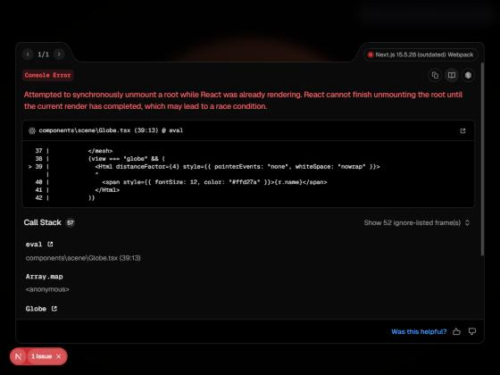
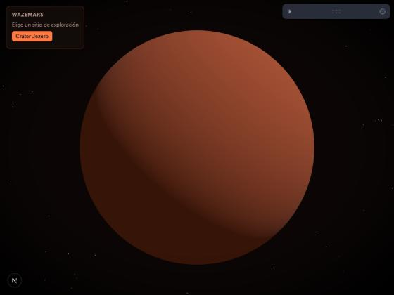
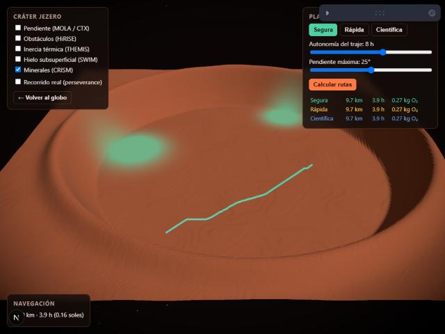

# Reporte de desarrollo: WazeMars

**Proyecto:** WazeMars (nombre provisional), mapa interactivo por capas y planificador de caminatas para Marte
**Reto:** NASA Space Apps Challenge 2026, *Interplanetary Survival Guide: Martian Map*
**Fecha del reporte:** 30 de octubre de 2026
**Estado:** esqueleto funcional de punta a punta con datos sintéticos; sin datos reales de NASA todavía

## 1. Resumen ejecutivo

Se partió de la presentación *Ruta Roja Martian Map* (12 diapositivas), se derivó de ella una planeación estructural y se construyó el esqueleto completo del monorepo con el stack tecnológico propuesto: Next.js + React Three Fiber en el frontend, FastAPI + scikit-image en el backend, y un pipeline offline en Python con Rasterio/GDAL que produce los datos que consumen ambos.

Al cierre de esta etapa:

- El flujo completo funciona en el navegador: globo 3D, selección del cráter Jezero, transición de cámara, terreno 3D por capas, selección de inicio y destino con clic, cálculo de rutas en los tres modos (Segura, Rápida, Científica) y panel de navegación con tiempo, O2, punto de no retorno, paradas y alertas.
- La API tiene 6 pruebas automatizadas que pasan, y el código de API y pipeline pasa `ruff`. El frontend pasa ESLint, la revisión de tipos de TypeScript y `next build`.
- Hay tres workflows de GitHub Actions (web, API y pipeline) y documentación de arranque y de arquitectura.
- **Lo que falta para la demo real** es, sobre todo, el trabajo de datos: descargar y procesar los productos reales de NASA (MOLA, CTX/HiRISE, THEMIS, CRISM, SWIM) y los recorridos reales de los rovers. Hoy la app trabaja con una región sintética de Jezero generada por el pipeline.

En números: unos 60 archivos de código y configuración, alrededor de 2,400 líneas, en 4 piezas (web, API, pipeline y contratos).

## 2. Punto de partida: la presentación

La presentación definía el producto y el stack. Los puntos que guiaron la implementación fueron:

| Diapositiva | Contenido | Cómo se reflejó en el código |
|---|---|---|
| El reto | Vista integrada por capas con datos de varias misiones para planear una Marswalk segura y con ciencia | Capas normalizadas por región y motor de rutas con costo multicriterio |
| La experiencia | Globo, zoom, capas, ruta y navegación en una sola escena 3D | Un único `<Canvas>`; el zoom es una transición de cámara |
| Capas de datos | MOLA, HiRISE/CTX, THEMIS, SWIM, CRISM, REMS/MEDA, recorridos reales | Capas `hazard`, `thermal_inertia`, `ice`, `minerals`, más pendiente desde el DEM y recorridos en GeoJSON |
| Motor de rutas | Costo = pendiente + riesgo + distancia + valor científico; A* o Dijkstra; tres modos; límites del traje | `engine/cost.py`, `engine/pathfind.py`, `SuitLimits` |
| Innovación | Supervivencia sobre distancia, ciencia en el camino, consumibles, validación con rovers | Paradas científicas, O2, punto de no retorno, superposición del recorrido real |
| Stack | Next.js, R3F, Drei, postprocessing, Leva, Theatre.js / FastAPI, NumPy, scikit-image, Pydantic / GDAL, Rasterio / Vercel, Render o Railway, R2, GitHub Actions | Se respetó completo |
| Despliegue | Explorador, Vercel, API, R2, pipeline offline previo al evento | API con assets en disco (desarrollo) o R2 (producción) |
| Flujo de una ruta | Elegir, enviar, cargar grilla, calcular, dibujar | Implementado tal cual, con grillas precalculadas y caché en memoria |
| Roles | Seis roles | Cada rol tiene carpetas asignadas en el README |

## 3. Proceso seguido

El trabajo se hizo en cuatro etapas.

### 3.1 Análisis de la presentación

Se extrajo el texto de las 12 diapositivas del `.pptx` y se identificaron requisitos funcionales (capas, modos, límites del traje, consumibles, validación), restricciones (sin Unity ni modelado manual, preprocesar antes del evento) y el reparto de roles.

### 3.2 Planeación estructural

Se definió, sin fechas:

- Arquitectura de tres piezas desplegables por separado más un pipeline offline, con la regla de que **todo lo pesado se precalcula**.
- Estructura del monorepo y responsabilidades de cada carpeta.
- Formato de datos por región (manifest, grillas `.npy`, texturas, heightmap y recorridos).
- Contrato REST de la API.
- Ocho fases ordenadas por dependencia: cimientos, datos de una región, motor mínimo, escena mínima, capas y modos, navegación, validación y pulido de la demo.
- Asignación de roles y una tabla de riesgos con mitigaciones.

### 3.3 Construcción del esqueleto

Se construyó en este orden, para poder probar cada pieza sobre la anterior:

1. **Raíz del monorepo:** workspaces de npm, `.gitignore` y `.env.example`.
2. **API:** esquemas, almacenamiento, motor, routers y pruebas. Se verificó con `pytest` y `ruff` antes de seguir.
3. **Pipeline:** configuración de regiones, reproyección, derivados del terreno, exportación, generador sintético y publicación a R2. Se generó la región sintética de Jezero y se probó la API contra ella.
4. **Web:** estado global, cliente de la API, conversión geográfica, escena 3D y paneles. Se verificó con revisión de tipos, lint, build y en el navegador.
5. **CI y documentación.**

### 3.4 Verificación en el navegador

Se levantaron la API y la web localmente y se recorrió el flujo completo en el navegador integrado. Esa prueba destapó tres problemas que las pruebas automáticas no detectaban (sección 7) y que se corrigieron en el momento.

## 4. Arquitectura

```
Explorador (navegador)
      |
      v
apps/web  (Next.js + R3F, Vercel) ---- REST ----> apps/api (FastAPI, Render/Railway)
      |                                                 |
      +---- texturas y heightmap ----+      grillas .npy |
                                     v                  v
                          Cloudflare R2  (en desarrollo: data/regions servido por la API en /assets)
                                     ^
                                     |
                pipeline (Python + Rasterio/GDAL, offline, antes del evento)
                                     ^
                                     |
                     Datos de NASA: PDS, Mars Trek, SWIM
```

Decisiones de fondo:

- **Grillas precalculadas por región.** La API no hace procesamiento geoespacial; solo combina grillas ya normalizadas y corre A*. Por eso la imagen Docker de la API no necesita GDAL.
- **El costo se combina en la API, no en el pipeline.** Así cambiar de modo o ajustar pesos no obliga a reprocesar datos.
- **Mismo formato en desarrollo y producción.** La API lee de `ASSETS_DIR` (disco) o `ASSETS_URL` (R2). En desarrollo, además, sirve los archivos en `/assets`, de modo que la web no depende de R2 para trabajar.
- **Datos sintéticos desde el primer día.** El pipeline genera una región con forma de cráter, para que web y API avancen en paralelo con el trabajo de datos reales.

## 5. Estructura del repositorio

```
SpaceAppsChallenge2026/
├── apps/
│   ├── api/                     FastAPI
│   │   ├── app/
│   │   │   ├── engine/          cost, pathfind, consumables, science, constraints, planner
│   │   │   ├── routers/         health, regions, routes
│   │   │   ├── schemas/         modelos Pydantic (contrato de la API)
│   │   │   ├── storage/         lectura de regiones desde disco o R2, con caché
│   │   │   ├── config.py, geo.py, main.py
│   │   ├── tests/               conftest, test_engine, test_api
│   │   ├── Dockerfile, pyproject.toml
│   └── web/                     Next.js
│       ├── app/                 layout, page, estilos
│       ├── components/
│       │   ├── scene/           Scene, Globe, CameraRig, RegionTerrain, RoutePath, TraverseOverlay
│       │   ├── ui/              SitePanel, LayerPanel, RoutePanel, NavPanel
│       │   └── debug/           controles Leva
│       └── lib/                 api, geo, store (Zustand), types, theatre
├── pipeline/
│   ├── config/regions.yaml      Jezero y Gale
│   └── marsdata/                fetch, process, export, synthetic, publish, run (CLI)
├── packages/contracts/          tipos TS generados desde el OpenAPI
├── data/regions/                salida del pipeline (no se versiona)
├── docs/                        arquitectura, este reporte, capturas
├── .github/workflows/           web.yml, api.yml, pipeline.yml
└── README.md
```

## 6. Componentes construidos

### 6.1 API (FastAPI)

**Endpoints**

| Método | Ruta | Función |
|---|---|---|
| GET | `/health` | Estado del servicio |
| GET | `/regions` | Lista resumida de regiones |
| GET | `/regions/{id}` | Manifest completo de una región |
| GET | `/regions/{id}/traverse/{rover}` | Recorrido real del rover en GeoJSON |
| POST | `/routes` | Una ruta en el modo pedido |
| POST | `/routes/compare` | Las rutas de los tres modos a la vez |
| GET | `/assets/...` | Solo en desarrollo: archivos de `data/regions` |

Los errores se traducen a códigos HTTP claros: 404 si la región no existe y 422 si el punto está fuera de la región, cae en una pendiente intransitable o no hay ruta posible.

**Motor de rutas**

1. **Costo por celda** (`engine/cost.py`):
   `costo = 1 + w_pendiente·(pendiente/máx)² + w_riesgo·hazard + w_inestabilidad·(1 − inercia térmica)`, multiplicado por `(1 − w_ciencia·minerales)`, con un mínimo de 0.1 por celda. Las celdas con pendiente mayor a la máxima del traje valen infinito (intransitables).

| Modo | Pendiente | Riesgo | Inestabilidad | Ciencia |
|---|---|---|---|---|
| Segura | 4.0 | 4.0 | 2.0 | 0 |
| Rápida | 0.5 | 1.0 | 0.3 | 0 |
| Científica | 1.5 | 2.0 | 1.0 | 0.8 |

2. **Búsqueda** (`engine/pathfind.py`): `MCP_Geometric` de scikit-image (Dijkstra/A* sobre la grilla, con conexión en 8 direcciones y costo geométrico en diagonales). Antes de buscar se valida que el inicio y el destino sean caminables.
3. **Tiempo y consumibles** (`engine/consumables.py`): velocidad por tramo con la función de Tobler escalada a 2.5 km/h en plano con traje, distancia 3D por segmento, duración en horas y soles (1 sol = 24.66 h) y consumo de referencia de 0.07 kg/h de O2. El punto de no retorno es el primer punto donde ya se gastó la mitad de la autonomía.
4. **Paradas** (`engine/science.py`): puntos de la ruta con minerales o hielo por encima de 0.6, priorizados por valor y separados al menos 15 puntos entre sí.
5. **Alertas** (`engine/constraints.py`): tramos con más del 80% de la pendiente máxima, exceso de autonomía y distancia a la base mayor que la permitida.
6. **Orquestación** (`engine/planner.py`): une los pasos anteriores y arma la respuesta.

**Pruebas** (6 en total, todas pasan):

- La ruta rodea un muro empinado por el único hueco disponible.
- Un destino inalcanzable lanza `NoPathError`.
- El modo Científico se desvía hacia una franja de minerales y el modo Rápido no.
- La ruta completa reporta tiempo, punto de no retorno y alertas de autonomía y distancia.
- La API responde `/health`, `/regions`, `/routes` y `/routes/compare` contra una región escrita a disco.
- Una región inexistente responde 404.

### 6.2 Pipeline de datos

CLI `marsdata` con cuatro comandos:

| Comando | Qué hace | Estado |
|---|---|---|
| `marsdata synthetic` | Genera una región de prueba con forma de cráter | Funciona |
| `marsdata fetch` | Descarga los productos de NASA a `data/raw/` | Pendiente (lanza `NotImplementedError` con instrucciones) |
| `marsdata build` | Reproyecta los GeoTIFF crudos a la grilla común, calcula la pendiente y normaliza las capas | Implementado, sin probar con datos reales |
| `marsdata publish` | Sube `data/regions/` a Cloudflare R2 (API compatible con S3) | Implementado, sin probar contra R2 |

Piezas principales:

- `region.py`: lee `regions.yaml` y calcula la resolución de la grilla.
- `process/reproject.py`: reproyecta con Rasterio a coordenadas geográficas sobre la esfera de Marte (R = 3,389.5 km) y rellena huecos.
- `process/terrain.py`: pendiente en grados desde el DEM y normalización robusta por percentiles.
- `export.py`: escribe el manifest, las grillas `.npy`, el heightmap de 16 bits, las texturas RGBA por capa, los recorridos en GeoJSON y el índice de regiones.
- `synthetic.py`: cráter con fondo plano, pared empinada, borde elevado y un abanico deltaico al oeste; rocas, inercia térmica, minerales (delta y carbonatos), hielo hacia el norte y un recorrido falso desde el sitio de amartizaje de Perseverance.

La región sintética de Jezero mide 512 × 512 celdas sobre un bbox de 0.35° (unos 40 m por celda).

### 6.3 Frontend (Next.js + React Three Fiber)

- **Una sola escena 3D** (`Scene.tsx`) con estrellas, luz direccional, bloom y viñeta.
- **Globo** (`Globe.tsx`) con rotación lenta y un marcador por región. Hoy es de color plano; falta la textura MOLA.
- **Transición** (`CameraRig.tsx`): al elegir un sitio, la cámara se acerca al marcador sobre el globo y, al llegar, el globo se reemplaza por el terreno detallado de la región.
- **Terreno** (`RegionTerrain.tsx`): un plano de 192 × 192 segmentos desplazado con el heightmap, con sombreado plano (estética low poly) y exageración vertical ajustable. Las capas activas se dibujan encima como texturas semitransparentes con el mismo desplazamiento. Un clic sobre el terreno se convierte a latitud y longitud.
- **Rutas** (`RoutePath.tsx`): las tres rutas a la vez, con la del modo activo resaltada, más marcadores de inicio, destino y paradas.
- **Recorrido real** (`TraverseOverlay.tsx`): línea punteada del rover, que hoy flota a la altura máxima porque el GeoJSON no trae elevación.
- **Paneles:** sitios (globo), capas y recorrido real, planificación (modo, autonomía, pendiente máxima, tabla comparativa) y navegación (resumen, punto de no retorno, paradas, alertas).
- **Estado global** con Zustand (`lib/store.ts`), **cliente REST** tipado (`lib/api.ts`) y **conversiones geográficas** compartidas por todas las piezas de la escena (`lib/geo.ts`).
- **Leva** para ajustes en desarrollo (sol, exageración vertical, bloom; se oculta en producción) y **Theatre.js** preparado para la secuencia de la demo.

### 6.4 Contratos, CI y documentación

- `packages/contracts`: genera tipos TypeScript desde el OpenAPI de FastAPI con `openapi-typescript`. Mientras no se generen, la web usa tipos escritos a mano en `lib/types.ts`.
- **GitHub Actions:**
  - `web.yml`: lint, revisión de tipos y build.
  - `api.yml`: `ruff check`, `ruff format --check` y `pytest`.
  - `pipeline.yml`: ejecución manual que genera una región, la guarda como artefacto y opcionalmente la publica en R2 con secretos del repositorio.
- **Documentación:** `README.md` (arranque local y roles por carpeta) y `docs/arquitectura.md` (flujo, formato de datos, API, modos y pendientes).

## 7. Problemas encontrados y cómo se resolvieron

| # | Problema | Causa | Solución |
|---|---|---|---|
| 1 | El primer intento de crear los archivos de la API falló sin escribir nada | Un script largo de heredocs no se pudo interpretar en Git Bash de Windows | Se escribió cada archivo por separado |
| 2 | Una prueba de la API fallaba con "invalid unicode code point" | En Windows, `write_text` usa la codificación del sistema (cp1252) y el nombre "Región" se corrompía | Se fijó `encoding="utf-8"` en todas las escrituras de texto, también en el pipeline |
| 3 | `ruff` marcó `WalkMode(str, Enum)` | Python 3.11+ tiene `StrEnum` | Se cambió a `StrEnum` |
| 4 | La prueba del modo Científico estaba mal calibrada | Una mancha de minerales pequeña no compensaba el desvío, así que el resultado esperado era incorrecto | Se rediseñó con una franja de minerales cuyo desvío sí conviene |
| 5 | La revisión de tipos falló en las capas del terreno | `MeshBasicMaterial` no soporta `displacementMap`, así que las capas habrían quedado planas bajo el relieve | Se cambió a `MeshLambertMaterial` |
| 6 | En el navegador no aparecían las etiquetas del globo y Next.js mostraba "Attempted to synchronously unmount a root" | Incompatibilidad del componente `<Html>` de drei con React 19. Se probó a desactivar StrictMode y no fue la causa (se revirtió) | Se quitó `<Html>`: los sitios se eligen desde un panel en la página (más accesible) y el detalle de las paradas está en el panel de navegación |
| 7 | Al entrar a la región, la cámara quedaba demasiado cerca del terreno | `OrbitControls` guarda su propio estado y anulaba la pose nueva | Se registró como control por defecto y se sincroniza su objetivo en cada cambio de vista |
| 8 | "Failed to fetch" en el panel de sitios (captura del 30/10) | La API local estaba apagada: se detuvo al terminar la verificación | No es un defecto del código. Basta levantar la API (sección 10). Se podría mejorar el mensaje para decir que la API no responde |




## 8. Verificación y resultados

| Verificación | Resultado |
|---|---|
| `pytest` en la API | 6 de 6 pasan |
| `ruff check` / `ruff format` (API y pipeline) | Sin errores |
| `eslint` en la web | Sin errores |
| `tsc --noEmit` en la web | Sin errores |
| `next build` | Compila; la página principal pesa 352 kB en la primera carga |
| `marsdata synthetic` | Genera la región de Jezero con todas sus capas, texturas, heightmap y recorrido |
| API contra Jezero sintético | Base a delta: 7.93 km, 3.35 h, de 2 a 3 paradas según el modo |
| Prueba manual en el navegador | Globo, zoom, terreno, capa de minerales, clic de inicio y destino y tres rutas: 9.7 km, 3.9 h y 0.27 kg de O2 por ruta |






**Observación sobre los resultados.** Con la región sintética, los tres modos dieron prácticamente la misma ruta. No es un fallo del motor (las pruebas unitarias muestran que los modos sí se separan cuando el terreno lo justifica): el fondo del cráter sintético es casi plano y los minerales quedan lejos de la línea recta entre los puntos elegidos. Con datos reales, o con una región sintética con más contraste, deberían diferenciarse.

## 9. Avance por fase del plan

| Fase | Estado | Comentario |
|---|---|---|
| 1. Cimientos | Hecha en local | Monorepo, contratos y CI listos. Falta crear el repositorio git y los despliegues en Vercel, Render/Railway y R2 |
| 2. Datos de una región | Parcial | Pipeline completo con datos sintéticos; la descarga y el procesamiento real están pendientes |
| 3. Motor mínimo | Hecha | Además del modo Segura, ya están los tres modos |
| 4. Escena mínima | Hecha | Globo, transición, terreno y ruta |
| 5. Capas y modos | Hecha | Cinco capas y comparación de modos |
| 6. Navegación | Mayormente hecha | Paradas, tiempo, O2, punto de no retorno y alertas de límites; faltan las alertas de clima |
| 7. Validación | Iniciada | Superposición del recorrido (falso por ahora); faltan el recorrido real y las métricas de comparación |
| 8. Pulido de la demo | Pendiente | Textura del globo, secuencia de Theatre.js, rendimiento en tablet y guion |

## 10. Cómo ejecutarlo

Requisitos: Node 22 o superior y Python 3.11 o superior. En Windows se usa `.venv/Scripts/`; en macOS y Linux, `.venv/bin/`.

1. **Datos de prueba**

```
cd pipeline
python -m venv .venv
.venv/Scripts/pip install -e ".[dev]"
.venv/Scripts/marsdata synthetic
```

2. **API** en http://localhost:8000 (documentación interactiva en `/docs`). Debe estar corriendo para que la web no muestre "Failed to fetch".

```
cd apps/api
python -m venv .venv
.venv/Scripts/pip install -e ".[dev]"
cp .env.example .env
.venv/Scripts/uvicorn app.main:app --reload
```

3. **Web** en http://localhost:3000

```
npm install
cp apps/web/.env.example apps/web/.env.local
npm run dev:web
```

## 11. Pendientes, riesgos y recomendaciones

**Pendientes, por prioridad**

1. **Datos reales de Jezero** (camino crítico): implementar `fetch/sources.py` con los productos exactos de PDS, Mars Trek y SWIM, y correr `marsdata build`.
2. **Recorrido real de Perseverance** convertido a GeoJSON, con elevación muestreada del DEM para pegarlo al terreno.
3. **Despliegue:** repositorio git, proyecto en Vercel, servicio en Render o Railway, bucket R2 con CORS y secretos en GitHub.
4. **Métricas de validación** entre la ruta propuesta y el recorrido real (distancia, desnivel acumulado y separación media).
5. **Textura MOLA del globo**, secuencia de Theatre.js y alertas de clima con valores de referencia de REMS y MEDA.
6. **Calibración científica** de pesos y umbrales con el rol de ciencia, y una región sintética con más contraste para que la demo muestre la diferencia entre modos.
7. Reemplazar los tipos escritos a mano por los generados en `packages/contracts`.
8. Mejorar el mensaje de error cuando la API no responde.

**Riesgos**

| Riesgo | Mitigación |
|---|---|
| Los datos reales tardan más de lo previsto | La región sintética ya permite hacer la demo; si hace falta, usar solo MOLA y CTX |
| Capas desalineadas entre misiones | Todas se reproyectan a la misma grilla; conviene agregar una verificación de shape y transform antes de publicar |
| Pendiente distorsionada lejos del ecuador | Se asumen celdas cuadradas; para regiones de latitud alta, reproyectar a una proyección local equidistante |
| Precisión del relieve en la web | El navegador lee el heightmap de 16 bits como de 8 bits; si se notan escalones, pasar a una malla glTF o a un heightmap en formato de punto flotante |
| Arranque en frío de Render o Railway durante la demo | Hacer un ping previo o usar un plan sin suspensión el día del evento |

## 12. Conclusión

El proyecto pasó de una presentación conceptual a una aplicación que funciona de punta a punta, con el stack acordado por el equipo y sin desviaciones de fondo respecto a la arquitectura propuesta. Las piezas de software (motor de rutas, API, escena 3D, paneles y CI) están listas para recibir datos reales. El siguiente paso es el trabajo de datos geoespaciales sobre Jezero, que es el camino crítico de todo lo que queda.
