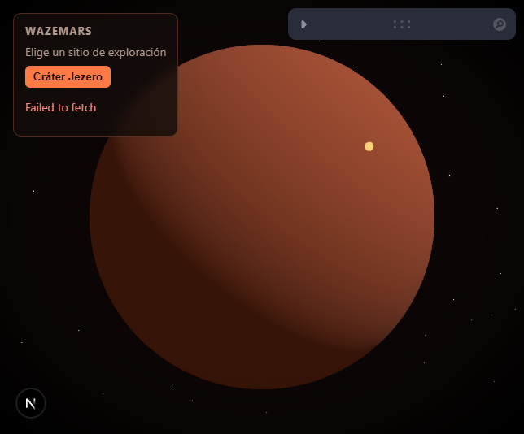
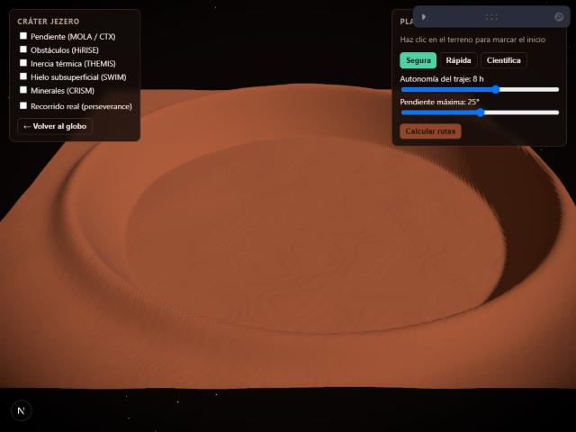

# Development report: WazeMars

> Historical report from 30 October 2026, before the real data. The project is now called Martian Route and
> its current state is in the [README](../README.md).

**Project:** WazeMars (provisional name), interactive layered map and walk planner for Mars
**Challenge:** NASA Space Apps Challenge 2026, *Interplanetary Survival Guide: Martian Map*
**Report date:** 30 October 2026
**Status:** end-to-end working skeleton with synthetic data; no real NASA data yet

## 1. Executive summary

We started from the *Ruta Roja Martian Map* presentation (12 slides), derived a structural plan from it and
built the full monorepo skeleton with the proposed stack: Next.js + React Three Fiber on the frontend, FastAPI +
scikit-image on the backend, and an offline Python pipeline with Rasterio/GDAL that produces the data both
consume.

At the end of this stage:

- The whole flow works in the browser: 3D globe, selection of Jezero Crater, camera transition, layered 3D
  terrain, start and destination selection by click, route computation in the three modes (Safe, Fast,
  Science) and a navigation panel with time, O2, point of no return, stops and alerts.
- The API has 6 automated tests that pass, and the API and pipeline code passes `ruff`. The frontend passes
  ESLint, TypeScript type checking and `next build`.
- There are three GitHub Actions workflows (web, API and pipeline) and setup and architecture documentation.
- **What is missing for the real demo** is mostly the data work: downloading and processing the real NASA
  products (MOLA, CTX/HiRISE, THEMIS, CRISM, SWIM) and the real rover traverses. Today the app works with a
  synthetic Jezero region generated by the pipeline.

In numbers: about 60 code and configuration files, around 2,400 lines, in 4 pieces (web, API, pipeline and
contracts).

## 2. Starting point: the presentation

The presentation defined the product and the stack. The points that guided the implementation were:

| Slide | Content | How it was reflected in the code |
|---|---|---|
| The challenge | Integrated layered view with data from several missions to plan a safe Marswalk with science | Normalized layers per region and a route engine with a multi-criteria cost |
| The experience | Globe, zoom, layers, route and navigation in a single 3D scene | A single `<Canvas>`; the zoom is a camera transition |
| Data layers | MOLA, HiRISE/CTX, THEMIS, SWIM, CRISM, REMS/MEDA, real traverses | Layers `hazard`, `thermal_inertia`, `ice`, `minerals`, plus slope from the DEM and traverses in GeoJSON |
| Route engine | Cost = slope + risk + distance + science value; A* or Dijkstra; three modes; suit limits | `engine/cost.py`, `engine/pathfind.py`, `SuitLimits` |
| Innovation | Survival over distance, science along the way, consumables, validation with rovers | Science stops, O2, point of no return, overlay of the real traverse |
| Stack | Next.js, R3F, Drei, postprocessing, Leva, Theatre.js / FastAPI, NumPy, scikit-image, Pydantic / GDAL, Rasterio / Vercel, Render or Railway, R2, GitHub Actions | Fully respected |
| Deployment | Explorer, Vercel, API, R2, offline pipeline before the event | API with assets on disk (development) or R2 (production) |
| Flow of a route | Pick, send, load grid, compute, draw | Implemented as is, with precomputed grids and an in-memory cache |
| Roles | Six roles | Each role has assigned folders in the README |

## 3. Process

The work was done in four stages.

### 3.1 Analysis of the presentation

The text of the 12 slides was extracted from the `.pptx` and we identified functional requirements (layers,
modes, suit limits, consumables, validation), constraints (no Unity or manual modeling, preprocess before the
event) and the split of roles.

### 3.2 Structural planning

We defined, without dates:

- A three-piece architecture deployable separately plus an offline pipeline, with the rule that **everything
  heavy is precomputed**.
- The monorepo structure and the responsibilities of each folder.
- The per-region data format (manifest, `.npy` grids, textures, heightmap and traverses).
- The API REST contract.
- Eight phases ordered by dependency: foundations, data for one region, minimal engine, minimal scene, layers
  and modes, navigation, validation and demo polish.
- Role assignment and a risk table with mitigations.

### 3.3 Building the skeleton

It was built in this order, so each piece could be tested on top of the previous one:

1. **Monorepo root:** npm workspaces, `.gitignore` and `.env.example`.
2. **API:** schemas, storage, engine, routers and tests. Checked with `pytest` and `ruff` before moving on.
3. **Pipeline:** region configuration, reprojection, terrain products, export, synthetic generator and
   publishing to R2. The synthetic Jezero region was generated and the API was tested against it.
4. **Web:** global state, API client, geographic conversion, 3D scene and panels. Checked with type checking,
   lint, build and in the browser.
5. **CI and documentation.**

### 3.4 Browser check

The API and the web were run locally and the whole flow was walked through in the built-in browser. That test
uncovered three problems the automated tests did not catch (section 7), which were fixed on the spot.

## 4. Architecture

```
Explorer (browser)
      |
      v
apps/web  (Next.js + R3F, Vercel) ---- REST ----> apps/api (FastAPI, Render/Railway)
      |                                                 |
      +---- textures and heightmap --+         .npy grids|
                                     v                  v
                          Cloudflare R2  (in development: data/regions served by the API at /assets)
                                     ^
                                     |
                pipeline (Python + Rasterio/GDAL, offline, before the event)
                                     ^
                                     |
                     NASA data: PDS, Mars Trek, SWIM
```

Core decisions:

- **Precomputed grids per region.** The API does no geospatial processing; it only combines already
  normalized grids and runs the route search. That is why the API Docker image does not need GDAL.
- **The cost is combined in the API, not in the pipeline.** That way changing the mode or tuning weights does
  not require reprocessing data.
- **Same format in development and production.** The API reads from `ASSETS_DIR` (disk) or `ASSETS_URL` (R2).
  In development it also serves the files at `/assets`, so the web does not depend on R2 to work.
- **Synthetic data from day one.** The pipeline generates a crater-shaped region, so the web and the API can
  move forward in parallel with the real data work.

## 5. Repository structure

```
SpaceAppsChallenge2026/
├── apps/
│   ├── api/                     FastAPI
│   │   ├── app/
│   │   │   ├── engine/          cost, pathfind, consumables, science, constraints, planner
│   │   │   ├── routers/         health, regions, routes
│   │   │   ├── schemas/         Pydantic models (the API contract)
│   │   │   ├── storage/         reading regions from disk or R2, with a cache
│   │   │   ├── config.py, geo.py, main.py
│   │   ├── tests/               conftest, test_engine, test_api
│   │   ├── Dockerfile, pyproject.toml
│   └── web/                     Next.js
│       ├── app/                 layout, page, styles
│       ├── components/
│       │   ├── scene/           Scene, Globe, CameraRig, RegionTerrain, RoutePath, TraverseOverlay
│       │   ├── ui/              SitePanel, LayerPanel, RoutePanel, NavPanel
│       │   └── debug/           Leva controls
│       └── lib/                 api, geo, store (Zustand), types, theatre
├── pipeline/
│   ├── config/regions.yaml      Jezero and Gale
│   └── marsdata/                fetch, process, export, synthetic, publish, run (CLI)
├── packages/contracts/          TS types generated from the OpenAPI
├── data/regions/                pipeline output (not versioned)
├── docs/                        architecture, this report, screenshots
├── .github/workflows/           web.yml, api.yml, pipeline.yml
└── README.md
```

## 6. Components built

### 6.1 API (FastAPI)

**Endpoints**

| Method | Path | Function |
|---|---|---|
| GET | `/health` | Service status |
| GET | `/regions` | Summary list of regions |
| GET | `/regions/{id}` | Full manifest of a region |
| GET | `/regions/{id}/traverse/{rover}` | The rover's real traverse as GeoJSON |
| POST | `/routes` | One route in the requested mode |
| POST | `/routes/compare` | The routes of the three modes at once |
| GET | `/assets/...` | Development only: files from `data/regions` |

Errors are translated into clear HTTP codes: 404 if the region does not exist and 422 if the point is outside
the region, falls on an impassable slope or there is no possible route.

**Route engine**

1. **Cost per cell** (`engine/cost.py`):
   `cost = 1 + w_slope·(slope/max)² + w_hazard·hazard + w_instability·(1 − thermal inertia)`, multiplied by
   `(1 − w_science·minerals)`, with a minimum of 0.1 per cell. Cells with a slope above the suit maximum are
   infinite (impassable).

| Mode | Slope | Hazard | Instability | Science |
|---|---|---|---|---|
| Safe | 4.0 | 4.0 | 2.0 | 0 |
| Fast | 0.5 | 1.0 | 0.3 | 0 |
| Science | 1.5 | 2.0 | 1.0 | 0.8 |

2. **Search** (`engine/pathfind.py`): scikit-image's `MCP_Geometric` (Dijkstra on the grid, with 8-direction
   connectivity and geometric cost on diagonals). Before searching it checks that start and destination are
   walkable.
3. **Time and consumables** (`engine/consumables.py`): speed per segment with Tobler's function scaled to
   2.5 km/h on flat ground with a suit, 3D distance per segment, duration in hours and sols (1 sol = 24.66 h)
   and a reference use of 0.07 kg/h of O2. The point of no return is the first point where half the autonomy
   has already been spent.
4. **Stops** (`engine/science.py`): route points with minerals or ice above 0.6, prioritized by value and at
   least 15 points apart.
5. **Alerts** (`engine/constraints.py`): segments above 80% of the maximum slope, exceeded autonomy and a
   distance to base larger than allowed.
6. **Orchestration** (`engine/planner.py`): joins the previous steps and builds the response.

**Tests** (6 in total, all pass):

- The route goes around a steep wall through the only available gap.
- An unreachable destination raises `NoPathError`.
- The Science mode detours toward a mineral strip and the Fast mode does not.
- The full route reports time, point of no return and autonomy and distance alerts.
- The API answers `/health`, `/regions`, `/routes` and `/routes/compare` against a region written to disk.
- A nonexistent region answers 404.

### 6.2 Data pipeline

`marsdata` CLI with four commands:

| Command | What it does | Status |
|---|---|---|
| `marsdata synthetic` | Generates a crater-shaped test region | Works |
| `marsdata fetch` | Downloads the NASA products into `data/raw/` | Pending (raises `NotImplementedError` with instructions) |
| `marsdata build` | Reprojects the raw GeoTIFFs to the common grid, computes the slope and normalizes the layers | Implemented, not tested with real data |
| `marsdata publish` | Uploads `data/regions/` to Cloudflare R2 (S3-compatible API) | Implemented, not tested against R2 |

Main pieces:

- `region.py`: reads `regions.yaml` and computes the grid resolution.
- `process/reproject.py`: reprojects with Rasterio to geographic coordinates on the Mars sphere
  (R = 3,389.5 km) and fills gaps.
- `process/terrain.py`: slope in degrees from the DEM and robust normalization by percentiles.
- `export.py`: writes the manifest, the `.npy` grids, the 16-bit heightmap, the RGBA textures per layer, the
  GeoJSON traverses and the region index.
- `synthetic.py`: a crater with a flat floor, a steep wall, a raised rim and a delta fan to the west; rocks,
  thermal inertia, minerals (delta and carbonates), ice to the north and a fake traverse from Perseverance's
  landing site.

The Jezero region is 600 × 600 cells over a 0.250° × 0.251° box where the NOAH-H mosaic has data in 95.4 % of
the cells (about 24.8 m per cell north to south). The synthetic terrain is anchored to a fixed geographic frame
(`FRAMES` in `synthetic.py`), so changing the box does not move it relative to the demo points.

### 6.3 Frontend (Next.js + React Three Fiber)

- **A single 3D scene** (`Scene.tsx`) with stars, directional light, bloom and vignette.
- **Globe** (`Globe.tsx`) with slow rotation and a marker per region. Today it is a flat color; the MOLA
  texture is missing.
- **Transition** (`CameraRig.tsx`): when a site is picked, the camera approaches the marker on the globe and,
  on arrival, the globe is replaced by the region's detailed terrain.
- **Terrain** (`RegionTerrain.tsx`): a 192 × 192 segment plane displaced with the heightmap, with flat shading
  (low-poly look) and adjustable vertical exaggeration. The active layers are drawn on top as semi-transparent
  textures with the same displacement. A click on the terrain is converted to latitude and longitude.
- **Routes** (`RoutePath.tsx`): the three routes at once, with the active mode highlighted, plus start,
  destination and stop markers.
- **Real traverse** (`TraverseOverlay.tsx`): the rover's dotted line, which today floats at the maximum height
  because the GeoJSON has no elevation.
- **Panels:** sites (globe), layers and real traverse, planning (mode, autonomy, maximum slope, comparison
  table) and navigation (summary, point of no return, stops, alerts).
- **Global state** with Zustand (`lib/store.ts`), a typed **REST client** (`lib/api.ts`) and **geographic
  conversions** shared by every piece of the scene (`lib/geo.ts`).
- **Leva** for development tweaks (sun, vertical exaggeration, bloom; hidden in production) and **Theatre.js**
  ready for the demo sequence.

### 6.4 Contracts, CI and documentation

- `packages/contracts`: generates TypeScript types from FastAPI's OpenAPI with `openapi-typescript`. Until
  they are generated, the web uses hand-written types in `lib/types.ts`.
- **GitHub Actions:**
  - `web.yml`: lint, type checking and build.
  - `api.yml`: `ruff check`, `ruff format --check` and `pytest`.
  - `pipeline.yml`: manual run that generates a region, saves it as an artifact and optionally publishes it to
    R2 with repository secrets.
- **Documentation:** `README.md` (local setup and roles per folder) and `docs/arquitectura.md` (flow, data
  format, API, modes and pending work).

## 7. Problems found and how they were solved

| # | Problem | Cause | Solution |
|---|---|---|---|
| 1 | The first attempt to create the API files failed without writing anything | A long heredoc script could not be parsed in Git Bash on Windows | Each file was written separately |
| 2 | An API test failed with "invalid unicode code point" | On Windows, `write_text` uses the system encoding (cp1252) and the name "Región" got corrupted | `encoding="utf-8"` was set on every text write, in the pipeline too |
| 3 | `ruff` flagged `WalkMode(str, Enum)` | Python 3.11+ has `StrEnum` | Changed to `StrEnum` |
| 4 | The Science mode test was badly calibrated | A small mineral patch did not compensate the detour, so the expected result was wrong | Redesigned with a mineral strip whose detour does pay off |
| 5 | Type checking failed on the terrain layers | `MeshBasicMaterial` does not support `displacementMap`, so the layers would have stayed flat under the relief | Changed to `MeshLambertMaterial` |
| 6 | The globe labels did not appear in the browser and Next.js showed "Attempted to synchronously unmount a root" | Incompatibility of drei's `<Html>` component with React 19. Disabling StrictMode was tried and was not the cause (reverted) | `<Html>` was removed: sites are picked from a panel on the page (more accessible) and the stop details are in the navigation panel |
| 7 | When entering the region, the camera was too close to the terrain | `OrbitControls` keeps its own state and overrode the new pose | It was registered as the default control and its target is synced on every view change |
| 8 | "Failed to fetch" in the sites panel (screenshot of 30/10) | The local API was off: it stopped when the check ended | Not a code defect. Just start the API (section 10). The message could be improved to say the API is not answering |




## 8. Verification and results

| Check | Result |
|---|---|
| `pytest` on the API | 6 of 6 pass |
| `ruff check` / `ruff format` (API and pipeline) | No errors |
| `eslint` on the web | No errors |
| `tsc --noEmit` on the web | No errors |
| `next build` | Builds; the main page weighs 352 kB on first load |
| `marsdata synthetic` | Generates the Jezero region with all its layers, textures, heightmap and traverse |
| API against synthetic Jezero | Base to delta: 7.93 km, 3.35 h, 2 to 3 stops depending on the mode |
| Manual browser test | Globe, zoom, terrain, mineral layer, start and destination click and three routes: 9.7 km, 3.9 h and 0.27 kg of O2 per route |





**Note on the results.** With the synthetic region, the three modes gave practically the same route. It is not
an engine failure (the unit tests show the modes do separate when the terrain justifies it): the synthetic
crater floor is almost flat and the minerals are far from the straight line between the chosen points. With
real data, or with a synthetic region with more contrast, they should differ.

## 9. Progress by plan phase

| Phase | Status | Comment |
|---|---|---|
| 1. Foundations | Done locally | Monorepo, contracts and CI ready. The git repository and the Vercel, Render/Railway and R2 deployments are missing |
| 2. Data for one region | Partial | Full pipeline with synthetic data; the real download and processing are pending |
| 3. Minimal engine | Done | Besides the Safe mode, the three modes are in place |
| 4. Minimal scene | Done | Globe, transition, terrain and route |
| 5. Layers and modes | Done | Five layers and mode comparison |
| 6. Navigation | Mostly done | Stops, time, O2, point of no return and limit alerts; weather alerts are missing |
| 7. Validation | Started | Traverse overlay (fake for now); the real traverse and the comparison metrics are missing |
| 8. Demo polish | Pending | Globe texture, Theatre.js sequence, tablet performance and script |

## 10. How to run it

Requirements: Node 22 or later and Python 3.11 or later. On Windows use `.venv/Scripts/`; on macOS and Linux,
`.venv/bin/`.

1. **Test data**

```
cd pipeline
python -m venv .venv
.venv/Scripts/pip install -e ".[dev]"
.venv/Scripts/marsdata synthetic
```

2. **API** at http://localhost:8000 (interactive docs at `/docs`). It must be running so the web does not show
   "Failed to fetch".

```
cd apps/api
python -m venv .venv
.venv/Scripts/pip install -e ".[dev]"
cp .env.example .env
.venv/Scripts/uvicorn app.main:app --reload
```

3. **Web** at http://localhost:3000

```
npm install
cp apps/web/.env.example apps/web/.env.local
npm run dev:web
```

## 11. Pending work, risks and recommendations

**Pending work, by priority**

1. **Real Jezero data** (critical path): implement `fetch/sources.py` with the exact PDS, Mars Trek and SWIM
   products, and run `marsdata build`.
2. **Perseverance's real traverse** converted to GeoJSON, with elevation sampled from the DEM to lay it on the
   terrain.
3. **Deployment:** git repository, Vercel project, Render or Railway service, R2 bucket with CORS and GitHub
   secrets.
4. **Validation metrics** between the proposed route and the real traverse (distance, cumulative ascent and
   mean separation).
5. **Globe MOLA texture**, Theatre.js sequence and weather alerts with REMS and MEDA reference values.
6. **Scientific calibration** of weights and thresholds with the science role, and a synthetic region with more
   contrast so the demo shows the difference between modes.
7. Replace the hand-written types with the ones generated in `packages/contracts`.
8. Improve the error message when the API does not answer.

**Risks**

| Risk | Mitigation |
|---|---|
| The real data takes longer than planned | The synthetic region already allows the demo; if needed, use only MOLA and CTX |
| Misaligned layers between missions | All are reprojected to the same grid; a shape and transform check before publishing is advisable |
| Distorted slope far from the equator | Square cells are assumed; for high-latitude regions, reproject to a local equidistant projection |
| Relief precision on the web | The browser reads the 16-bit heightmap as 8-bit; if steps show up, move to a glTF mesh or a floating-point heightmap |
| Render or Railway cold start during the demo | Ping beforehand or use a plan without sleep on event day |

## 12. Conclusion

The project went from a conceptual presentation to an application that works end to end, with the stack the
team agreed on and with no core deviations from the proposed architecture. The software pieces (route engine,
API, 3D scene, panels and CI) are ready to receive real data. The next step is the geospatial data work on
Jezero, which is the critical path for everything that remains.
